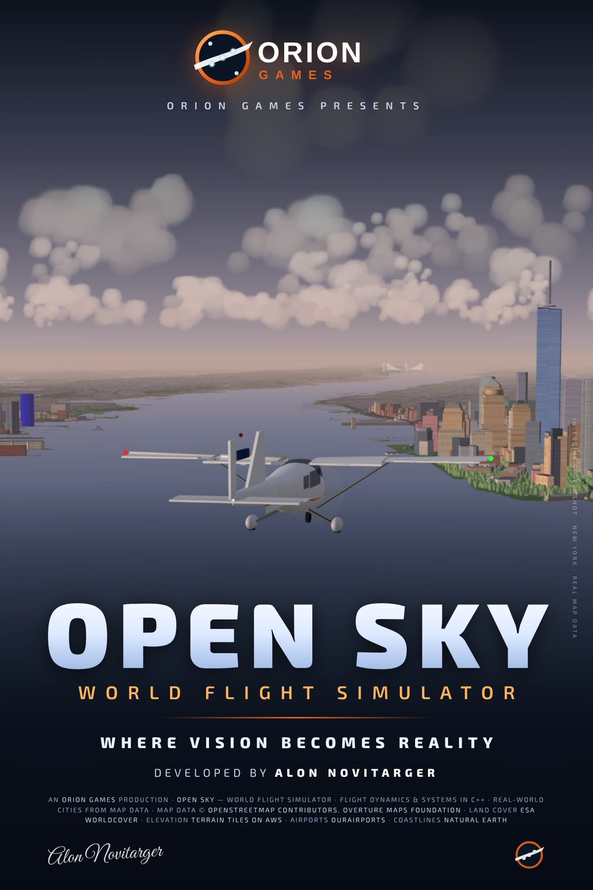

# GLOBAL SKIES: Infinite Horizon

**ORION GAMES** · פותח על ידי **ALON NOVITARGER** · *WHERE VISION BECOMES REALITY*
© 2026 ALON NOVITARGER. All Rights Reserved.

סימולטור טיסה בעולם פתוח המבוסס על כדור הארץ האמיתי. בוחרים מטוס בהאנגר ומקום על הגלובוס,
מתניעים, מסיעים עם הפיקוח, ממריאים, טסים מעל ערים שנבנו מנתוני מפה אמיתיים, נוחתים ומקבלים תחקיר.
מודל הטיסה הוא ליבת C++ שמקומפלת ל-WebAssembly. לכל מטוס יש מודל אווירודינמי, מנועים, מערכות
ומודל נזק משלו.



## הרצה

המשחק רץ בדפדפן (Chrome, Edge או Firefox עדכניים, עם WebGL 2). אין שלב בנייה, צריך רק שרת קבצים סטטי:

```bash
cd open-sky/web
python3 -m http.server 8123
# לפתוח http://localhost:8123/
```

* **פתיח**: הלוגו והחתימה כמו בפוסטר. סמל ה-A והמילה ORION נגזרו ישירות מהפוסטר, והחתימה היא החתימה האמיתית
  של ALON NOVITARGER. המסלול נחשף בתנועה סביב ה-A, והחתימה נכתבת על המסך. יש מוזיקה מסונתזת, לחיצה כלשהי מדלגת,
  ואפשר להפעיל את הפתיח שוב מההגדרות.
* **Hangar**: 26 מטוסים אמיתיים, עם תצוגה תלת-ממדית מסתובבת ונתוני ביצועים. המטוס שנבחר משמש בכל סוגי הטיסה.
* **Quick flight**: טיסה מהירה ב-JFK עם המטוס שנבחר.
* **Missions**: הדרכה ו-12 משימות. בהן סיור שקיעה בלוס אנג'לס (שלט הוליווד, מצפה גריפית', סנטה מוניקה), נחיתת A380,
  שריפת מנוע בהמראה, גישה בסופת רעמים, מעבר נמוך ב-F-15 מעל ההדסון ושיוט על-קולי ב-F-22.
* **Free Flight**: גלובוס עם חיפוש. אפשר להתחיל בחניה, על המסלול, בגישה סופית, מעל השדה או בגובה שיוט.

## ערים ושדות תעופה

| אזור | שדות תעופה | פרטים |
|---|---|---|
| ניו יורק | JFK, LGA, EWR | כ-1.75 מיליון בניינים (94% עם גובה מדוד), פסל החירות, גשרי ברוקלין, מנהטן, ויליאמסבורג, ורזאנו ו-GWB, ראשי האמפייר סטייט והקרייזלר |
| לוס אנג'לס | LAX, SMO, BUR, VNY | כ-940 אלף בניינים (99.6% עם גובה מדוד), שלט הוליווד, מבנה ה-Theme ב-LAX, מצפה גריפית', גלגל הענק במזח סנטה מוניקה, גבעות סנטה מוניקה |
| תל אביב, לאס וגאס, הונולולו, אינסברוק, סאבה | LLBG, KLAS, PHNL, LOWI, TNCS | בניינים, כבישים, חופים ותבליט מנתוני מפה |
| כל העולם | 10,446 שדות | מסלולים אמיתיים ותבליט גלובלי |

מסביב לכל עיר מפורטת השטח עובר בהדרגה לפרברים כלליים, כך שהעיר לא נגמרת בקו ישר.

## הצי

26 מטוסים אמיתיים, מהמטוס הפרטי ועד מטוס הנוסעים ומטוס הקרב. לכל אחד מודל טיסה משלו בליבת ה-C++,
מכויל מול נתונים פומביים. כברירת מחדל מוצגים השמות האמיתיים, ובהגדרות אפשר לעבור לשמות עיצוב מקוריים.
צבעי החברות (ליבריז) מקוריים.

| קטגוריה | מטוסים |
|---|---|
| קל ואווירובטיקה | Cessna 172S, Extra 330LX |
| מטוסים פרטיים | Cessna Citation CJ4, Embraer Phenom 300E, Gulfstream G650, Bombardier Global 7500 |
| מטוסי נוסעים צרי גוף | Airbus A220-300, Embraer E195-E2, Boeing 737-800, Boeing 737 MAX 8, Airbus A320, Airbus A321neo |
| מטוסי נוסעים רחבי גוף | Boeing 767-300ER, Boeing 787-9, Airbus A330-900, Airbus A350-900, Boeing 777-300ER, Boeing 747-400, Airbus A380 |
| מטוסי קרב ומפציץ | F-15C, F-16C, F/A-18E, Eurofighter Typhoon, F-22, F-35A, B-2 |

**טיסה פשוטה עם כפתורים ברורים:** בתחתית המסך יש שורת כפתורים גדולים: דחף, כן נסע, מדפים, בלם אוויר, טייס אוטומטי,
מצערת אוטומטית, בלמים והתנעה. כל כפתור מראה את המקש שלו, ואפשר לכבות את השורה בהגדרות.

הביצועים מכוילים מול נתונים פומביים, ב-368 בדיקות אוטומטיות של הליבה:

* המראה במשקל המראה מרבי (MTOW).
* שיוט בטייס אוטומטי ובמצערת אוטומטית, עם בדיקת צריכת דלק.
* גישה מיוצבת.
* התנעת מנוע סילון.
* חוקי ה-Fly-by-wire, כולל הגנת גלגול ב-A220.
* מטוסי קרב: מבער אחורי, מגבילי g (F-16, F/A-18, Typhoon) ושיוט על-קולי.
* נזק.
* ריצת נחיתה עם ספוילרים והפיכת דחף.

הפירוט המלא ב-[docs/FLIGHT_MODEL.md](docs/FLIGHT_MODEL.md).

## שליטה (ברירת מחדל; כל המקשים ניתנים למיפוי מחדש ב-Controls)

| פעולה | מקלדת | גיימפד |
|---|---|---|
| גובה (Pitch) / גלגול (Roll) | W/S או ↑/↓, A/D או ←/→ | סטיק שמאלי |
| הגה כיוון / גלגל אף | Q / E | LT / RT |
| מצערת (מעל 92% במטוס קרב = מבער אחורי) | ‎=/-‎ או PageUp/PageDown | D-pad ↑/↓ |
| בלמים / בלם חניה | Space / B | B (עיגול) |
| מדפים | F (מטה) / V (מעלה) | X / Y |
| **כן נסע (גלגלים) למעלה/למטה** | **G** | |
| בלם אוויר / חימוש ספוילרים לנחיתה | / / Shift+/ | |
| הפיכת דחף (על הקרקע) | F2 | |
| מצערת אוטומטית / מהירות ‎±5 קשר | Shift+R / Shift+, Shift+. | |
| משיכת ידית כיבוי של מנוע בוער | Shift+F | |
| קיזוז (Trim) | [ / ] | D-pad ←/→ |
| תערובת דלק (במטוסי בוכנה) | U / J | |
| התנעה או כיבוי אוטומטיים (מריץ את רצף המתגים האמיתי) | Shift+E | |
| קשר: גלגל קשר רדיאלי | T, ואז עכבר או מספר | A |
| מצלמות: תא טייס, מעקב, כנף, מגדל, חלוף, חופשית | 1–6, ו-C למבט הבא | LB / RB |
| מבט חופשי בתא / זום | גרירה עם הכפתור הימני / גלגלת | סטיק ימני |
| טייס אוטומטי: הפעלה, HDG, ALT, כיוון ±5°, גובה ±100 | Z, X, Y, ‎, .‎, ;/' | לחיצה על הסטיק השמאלי (L3) |
| אורות נחיתה / חיצוניים | L / K | |
| מפה, רשימת תיוג, HUD | M, Shift+G, H | Back |
| שמירה, השהיה, עזרה, תפריט | O, P, F1, Esc | Start = השהיה |
| נתוני אבחון (fps, קריאות ציור, משולשים, ליבה, הזרמת עולם) | F3 | |

**תא טייס אינטראקטיבי.** כל ידית ומתג הם קלט אמיתי לליבת ה-C++, ואין אף כפתור שרק "מציג" פעולה.
במטוסי הסילון:

* ידיות דחף, ידיות הפיכת דחף, ידית בלם האוויר (לחיצה כשהיא סגורה מחמשת את הספוילרים) וידית מדפים עם עצירות.
* ידית כן הנסע וידיות האש של כל מנוע.
* מתגי בקרת דלק (RUN/CUTOFF) ובורר ההתנעה (OFF/NORM/START).
* לוח טייס אוטומטי (MCP) עם SPD, HDG, ALT ו-V/S.
* בלוח העליון: סוללה, גנרטורים, אוויוניקה ואורות.
* מסכים: PFD, ND (כולל תצוגת TCAS), EICAS ודף סטטוס עם תרשים נזק.

במטוסי הקרב יש HUD ושלושה מסכי MFD.

## מה חדש בגרסה 2.0

* **צי של 14 מטוסים**:
  * **מנוע טורבו-מניפה**: N1 ו-N2, התנעה אמיתית, מבער אחורי והפיכת דחף.
  * **חוקי Fly-by-wire**: פיקוד עומס, החזקת נתיב, הגנות זווית התקפה, גלגול וגובה אף.
  * **מערכות**: כן נסע מתקפל, ספוילרים, מצערת אוטומטית ומחוללים.
* **מודל נזק עם השלכות**:
  * פגיעה בכנף מורידה עילוי בצד הפגוע. כנף שניתקה בעומס יתר, בפגיעה בבניין או בפגיעה בקרקע גורמת לגלגול בלתי נשלט.
  * אובדן הזנב, שריפת מנוע וידיות כיבוי.
  * אובדן לחץ הידראולי, שמעביר את ה-Fly-by-wire לחוק ישיר.
  * דליפת דלק מכנף פגועה.
  * כשל חשמלי שמחשיך את המסכים.
  * קריסת רגלי נחיתה ונחיתת גחון שאפשר לשרוד.
  * רפרוף ושבר בעומס יתר במקום "התרסקות" מיידית.
  * אפקטים חזותיים: אש, עשן, אדי דלק, ניצוצות וחלקים שנופלים.
* **מזג אוויר**: סופות רעמים עם ברקים, הבזק ורעם שמתעכב לפי המרחק. גשם על השמשה, עם מגבים במטוסי סילון.
* **מראה**: השתקפויות שמיים ושמש בזכוכית של גורדי שחקים.
* **אודיו**: צליל מנוע סילון ומבער אחורי. אזהרות: פעמון אש, צופר כן נסע, רעד מוט וקריאות GPWS.
* **תנועה**: מטוסי נוסעים בשיוט בין שדות תעופה אמיתיים, בגבהים לפי חוק חצי העיגול. הם משאירים שובלי עיבוי ומופיעים ב-TCAS.
* **חשבון Google**: Sign in with Google ושמירה בענן (תיקיית appData פרטית ב-Google Drive).
  * יציאה מהחשבון מבטלת את הטוקן אצל Google ומוחקת אותו מהזיכרון.
  * ההגדרה מתוארת ב-[docs/ACCOUNTS.md](docs/ACCOUNTS.md).
* **מיתוג**: פתיח ORION GAMES עם מוזיקה, לוגו על זנב המטוסים, ושורת זכויות במסך הפתיחה, במסכי הטעינה ובאתחול ה-HUD.

## מעבר גרפי לפי חבילת threejs-game-skills

הפעלנו על המשחק את חבילת הכישורים [threejs-game-skills](https://github.com/majidmanzarpour/threejs-game-skills) (רישיון MIT):
המנהל (director), בניית גרפיקה ברמת AAA, עיצוב ממשק, ובדיקות QA. התוצאות המלאות, כולל צילומים לפני ואחרי וטבלת ציונים,
נמצאות ב-[artifacts/final-evidence.md](artifacts/final-evidence.md).

* **תאורה מבוססת תמונה**: השמיים של הרגע (צבע, שמש, לילה) נאפים ל-environment map, כך שצבע המטוס, המתכת והזכוכית משקפים אותם.
* **צבע וחומרים**: ציפוי מבריק (clearcoat) על צבע המטוס, תפרי לוחות ומסמרות בבליטה, טיטניום בנחירי המנועים, ציפוי מט במטוסי החמקנות.
* **צללים מהשמש** על המטוס עצמו (כנף על גוף, מסגרות על לוח המכשירים), מותאמים לאיכות הגרפיקה.
* **לילה**: חלונות נוסעים מוארים, תאורת לוגו על הזנב, זוהר עירוני באופק ואור חם של העיר על בטן המטוס.
* **עננים**: כל פיסת ענן מוצללת ככדור לפי כיוון השמש, עם בסיס שטוח, ראש מואר ו"שולי כסף" מול השמש.
* **עשן ואש**: עשן שמתפזר, מתבהר ומתדלדל עם הזמן במקום "צינור" שחור.
* **תא הטייס**: לוח מכשירים עם מרקם וברגים, מגן סנוור מעוגל, מסגרות למסכים, ריפוד, ידיות מעוצבות; גשם מוצג רק על החלונות.
* **ממשק**: רצועת נתוני טיסה עם תגיות מצב (כן נסע, מדפים, AP, A/T, אזהרות), מפה עם יבשה ומים אמיתיים, מסך נקי בתא הטייס,
  ו"טיסות מומלצות" במסך הבית.
* **כלי QA**: `tests/qa/` מריץ את בודק הקנבס של החבילה על 9 תרחישים קבועים (וו בדיקה `window.__THREE_GAME_TEST_HOOKS__`,
  פעיל רק בדפדפן אוטומטי או עם `?qa`).

## מעבר ביצועים ו-Bloom לפי חבילת threejs-skills

הפעלנו על המשחק את חבילת המדריכים [threejs-skills](https://github.com/alton47/threejs-skills) (רישיון MIT). השתמשנו בעיקר
בפרקי הביצועים, ה-post-processing, הצללים והטעינה. מדדנו קודם, ותיקנו את מה שבאמת היה יקר:

* **פחות קריאות ציור (draw calls)**:
  * בשדות התעופה כל שלט היה 6 קריאות. בשדה JFK לבד היו 147 שלטים, כלומר 882 קריאות.
  * עכשיו כל השלטים של שדה נאספים לשתי קריאות עם אטלס טקסטורות אחד. גם מספרי המסלולים וקווי ההמתנה מאוחדים.
  * הבניינים הרחוקים והכבישים בעיר מאוחדים לגושים של 4×4 ק"מ.
  * החלקים הקבועים של מטוסי התנועה ושל תא הטייס מאוחדים לפי חומר.
  * בתוצאה: על המסלול ב-JFK ירדנו מ-828 ל-250 קריאות. בתא הטייס בגישה לנחיתה ירדנו מ-1,850 ל-336, ובלוס אנג'לס מ-1,585 ל-268.
* **Bloom**:
  * בלילה אורות הניווט, המגדלור, אורות המסלול והעיר זוהרים. ביום רק השמש והברקים זוהרים.
  * הפעלה וכיבוי ב-Settings, והאפקט כבוי באיכות Low.
* **הידור shaders מראש** מאחורי מסך הטעינה, כך שאין גמגום בשניות הראשונות או במעבר הראשון לתא הטייס.
* **F3** מציג עכשיו גם קריאות ציור ומספר משולשים.
* **תיקונים קטנים**: חלון A/P בלוח הטייס האוטומטי, ו-normal bias לצללים על גופים מעוגלים.

## גבולות, בכנות

* **אין Ray tracing ואין מיפוי פוטוגרמטרי בדפדפן.** המשחק רץ ב-WebGL 2 בלי מנוע RT, והערים בנויות מנתוני מפה
  אמיתיים (Overture/OSM), לא מסריקות תלת-ממדיות. Google Photorealistic 3D Tiles דורשים מפתח API בתשלום של
  בעל המשחק, ואפשר לחבר אותם בהמשך.
* **תאי הטייס פונקציונליים, אבל לא העתק מדויק של המטוס האמיתי.** כל מתג קיים עובד, אבל אין במשחק כל
  מתג של המטוס האמיתי. למשל, אין FMS מלא, APU ולחץ תא.
* **הערים בנויות מנתוני מפה, לא מסריקה תלת-ממדית.** הבניינים בגובה ובצורת הבסיס האמיתיים, אבל החזיתות נוצרות
  אוטומטית. רק ציוני דרך נבחרים (שלט הוליווד, פסל החירות, הגשרים, ראשי גורדי שחקים) בנויים ביד.
* **Sign in with Google דורש Client ID של בעל המשחק** ואת כתובת האתר שבה הוא מתארח. בתוך תצוגת Artifact
  של Claude, מדיניות האבטחה של הדף חוסמת את ספריית Google, ולכן הכפתור מציג הודעה מתאימה.

## מבנה

```
open-sky/
├─ core/     ליבת סימולציה ב-C++17: מודל טיסה, צי, מנועים, Fly-by-wire, נזק, תנועה ובדיקות כיול
├─ web/      המשחק (WebGL2 / three.js), WASM ונתונים ארוזים
├─ tools/    צינור הנתונים ב-Python (Overture, OurAirports, Natural Earth, גבהים) והמיתוג
├─ tests/    בדיקות דפדפן אוטומטיות (Playwright): טרנר, צי, נזק, שיוט, חשבון, מצלמות וביצועים
└─ docs/     אפיון, מפת דרכים, מקורות נתונים, מודל טיסה, ביצועים, חשבונות ודוח בדיקות
```

בנייה מחדש של הליבה: `cd core && make test && make wasm js layout`. נדרשים clang עם wasm-ld, ו-binaryen
עבור wasm2js.

## רישוי

* © 2026 ALON NOVITARGER. All Rights Reserved. המשחק, הלוגו, השמות והעיצובים.
* נתוני מפה: © OpenStreetMap contributors (ODbL) ו-Overture Maps Foundation.
* כיסוי קרקע: ESA WorldCover (CC BY 4.0). גבהים: Terrain Tiles on AWS.
* שדות תעופה: OurAirports (נחלת הכלל). קווי חוף: Natural Earth (נחלת הכלל).
* three.js: רישיון MIT.
* שמות היצרנים וסוגי המטוסים מוזכרים כהפניה בלבד. אין במשחק לוגואים או צביעות של יצרנים או של חברות תעופה.
